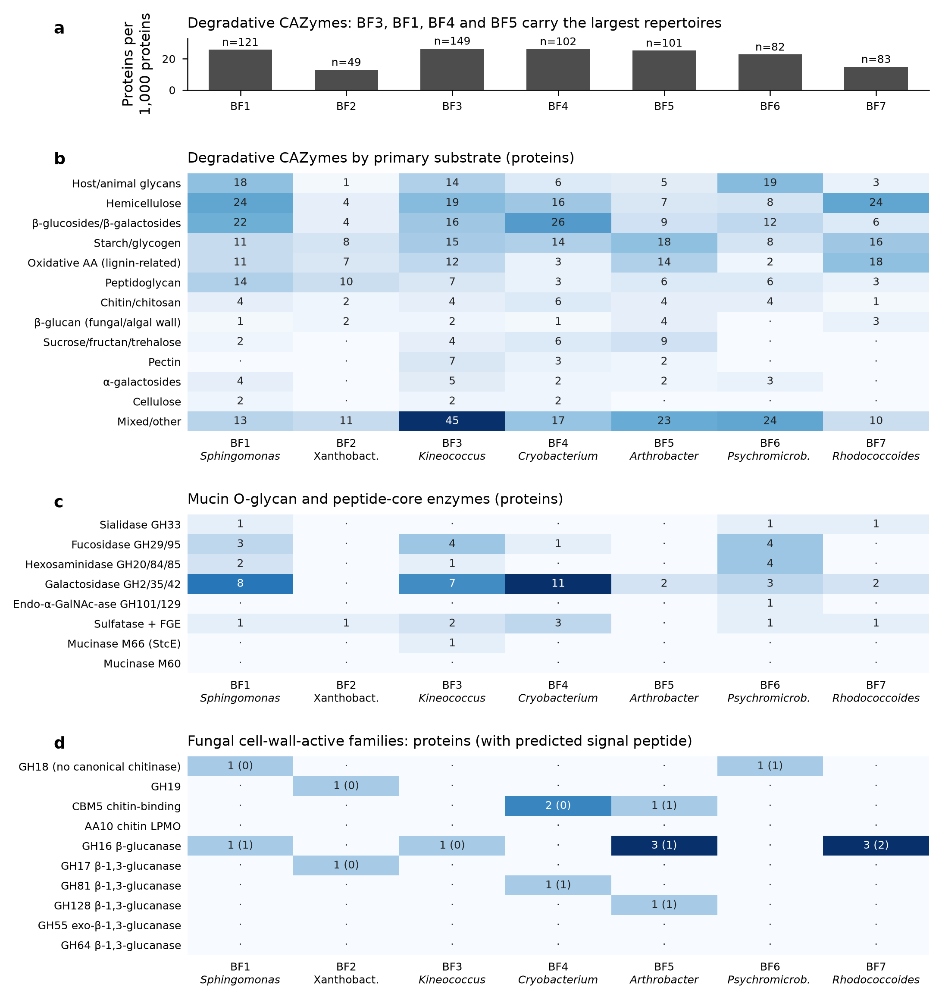
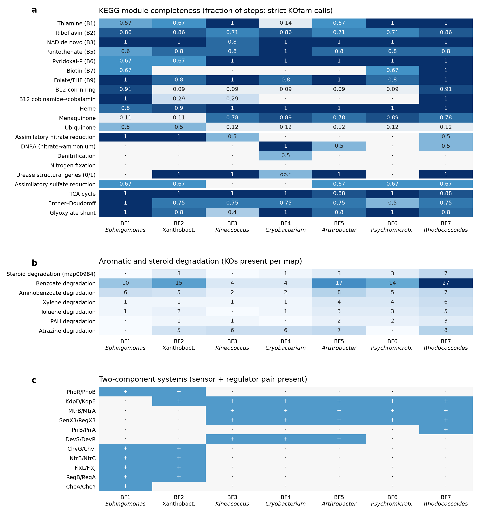
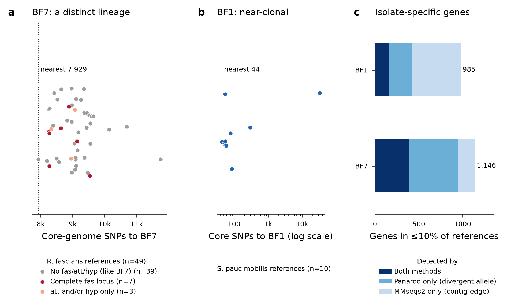

# 08. Functional genomics of BF1–BF7

Gene-content screens of the seven Bd-inhibitory bullfrog skin genomes: CAZymes (including mucin O-glycan and fungal cell-wall enzymes), KEGG metabolic modules, and a comparison of BF7 and BF1 with public genomes of their own species. **Gene presence indicates genetic capacity only;** no expression or activity was measured. Full tables: [functional_genomics_BF1-BF7.xlsx](functional_genomics_BF1-BF7.xlsx) (21 sheets; the `notes` sheet lists methods and caveats). Detailed methods: [methods/](methods/). Scripts: [../../code/functional_genomics/](../../code/functional_genomics/).

## Key findings
1. **No isolate encodes a canonical secreted chitinase or chitin LPMO (AA10).** The few GH18/GH19 proteins have non-chitinase architectures or no signal peptide. Secreted β-1,3-glucanase candidates are limited to GH16 in BF1, BF5 and BF7, GH81 in BF4 and GH128 in BF5. Direct enzymatic attack on the Bd cell wall is therefore at most a minor route in most isolates.
2. **Mucin-glycan enzymes are concentrated in BF6 (*Psychromicrobium*), BF1 (*Sphingomonas*) and BF3 (*Kineococcus*).**
   - Sialidase GH33 occurs in BF1, BF6 and BF7 (1 each). Fucosidases GH29/95 occur in BF1, BF3, BF4 and BF6, and hexosaminidases in BF1, BF3 and BF6.
   - BF6 alone has a secreted endo-α-GalNAc-ase (GH101).
   - BF3 has the only M66 (StcE-type) mucinase domain, and it is a weak hit. No isolate has M60.
   - No complete sialic-acid (*nanA-nanK-nanE*) or L-fucose (*fucI-fucK-fucA*) catabolic cluster was found. Only BF4 co-locates *nagA* and *nagB*.
   - So several isolates could release terminal mucin sugars, but full catabolic routes for those sugars were not detected.
3. **Overall degradative CAZyme capacity** (per 1,000 proteins) is highest in BF3, BF4, BF1 and BF5 (25–27) and lowest in BF2 (13.0) and BF7 (14.9).
4. **Vitamins and nitrogen differ sharply between isolates (KEGG).**
   - Only BF1 and BF7 can make cobalamin (B12) de novo.
   - Biotin synthesis genes are absent at threshold in BF2–BF5, a possible biotin requirement.
   - BF4 lacks thiamine synthesis and salvage genes at threshold.
   - Urease structural genes are in BF2, BF3, BF5 and BF7. BF4 has a contiguous *ureD-ureG-ureF-ureC-ureB-ureA* cluster in its Prokka annotation (no *ureE*), but *ureB* falls just below the KOfam threshold. Urease is absent from BF1 and BF6.
   - Only BF4 has respiratory nitrate reductase (*narGHI*).
   - These differences suggest cross-feeding dependencies, especially for B12, within skin communities.
5. **Steroid degradation genes are concentrated in BF7.** It has 6 cholesterol oxidases, 3-ketosteroid Δ1-dehydrogenase (KstD) and KshB, but no KshA at threshold; the other isolates have 0–3 map00984 KOs. BF7 also has the most benzoate-degradation KOs (27). This is consistent with sterol/steroid-catabolic capacity typical of *Rhodococcus*-like bacteria. Whether BF7 metabolises host skin sterols or glucocorticoids is untested.
6. **BF7 is a non-pathogenic-type *R. fascians* from a distinct lineage.**
   - It carries none of the 18 *fas/att/hyp* virulence genes of the pFiD188 plasmid and shares only 2 of its 184 CDS.
   - Among public genomes, 13 of 193 conspecific assemblies carry a complete *fas* locus.
   - BF7's nearest reference is 7,929 core SNPs away (maximum ANI 98.2%).
   - It has 1,146 isolate-specific genes in 50 islands. 24 islands have little homology in other *R. fascians* genomes. 10 carry biosynthesis-associated domains: 5 with NRPS/PKS multi-domain combinations and 5 with a single indicative domain.
   - Two large islands sit on plasmid-like (higher-coverage) contigs: a 135-kb lanthipeptide/RiPP-associated island (GI26) and a PKS/NRPS hybrid island (GI44).
7. **BF1 is near-clonal with public *S. paucimobilis*.** It is 44 core SNPs from FDAARGOS_881 over 1.72 Mb. Its 985 isolate-specific genes are mostly mobile/accessory content (59 islands, 13 on plasmid-like contigs, 1 with biosynthetic-domain signatures). So BF1's strong Bd inhibition, if genetically encoded, would have to sit in this accessory content or be shared with its clinical and environmental relatives.

## Figures

*(a) Degradative CAZyme proteins per 1,000 proteins (number above bar = proteins). (b) Degradative CAZymes by primary substrate. (c) Mucin O-glycan and peptide-core enzyme families. (d) Fungal cell-wall-active families: proteins (with a DeepSig-predicted signal peptide). GH109 (low-specificity Gfo/Idh fold) is excluded from (c).*

*(a) KEGG module completeness from strict KOfam calls. op.\* = BF4 has a contiguous ureDGF-CBA cluster in its Prokka annotation, but ureB is just below the KOfam threshold. (b) KOs present in aromatic and steroid degradation maps. (c) Two-component systems with both sensor and regulator present (systems absent from all isolates are omitted).*

*(a) Core-genome SNP distance from BF7 to 49 dereplicated R. fascians references, coloured by fas/att/hyp virulence-locus type. (b) Core-genome SNP distance from BF1 to 10 S. paucimobilis references (log scale). (c) Isolate-specific genes (present in ≤10% of references; genes on <5× contigs excluded), split by the clustering method(s) that support them.*

## Caveats
- **Assemblies:** draft assemblies (127–2,456 contigs) can split operons, so "not co-located" or "absent" is weak evidence of absence. BF4 and BF5 are two bins from one mixed culture.
- **KOfam thresholds:** they under-call divergent homologs in the novel taxa (BF2–BF6). See the near-threshold diagnostic table in the KEGG outputs (`curated_missing_steps_subthreshold_hits.tsv`).
- **Signal peptides:** predicted with DeepSig's classifier only (SignalP 6 is licence-gated), so no cleavage sites and no lipoprotein calls.
- **Islands:** biosynthetic flags are protein-domain proxies, not antiSMASH calls.
- **Comparative references:** the *S. paucimobilis* reference set is small (10 after dereplication). The type-strain assembly NCTC 11030 failed QC, but the type strain is still represented by NBRC 13935 and FDAARGOS_908.
- **Not run:** the planned curated screen for hormone and host-interaction markers was stopped by the analysis platform's content-safety filter. Its targets were steroid catabolism genes, auxin/cytokinin pathways, quorum sensing/quenching, antimicrobial-peptide resistance, iron uptake, cyanide/secretion systems, amine decarboxylases and cold/stress genes. The KEGG results cover part of it: steroid map00984 KOs, urease and two-component systems.
