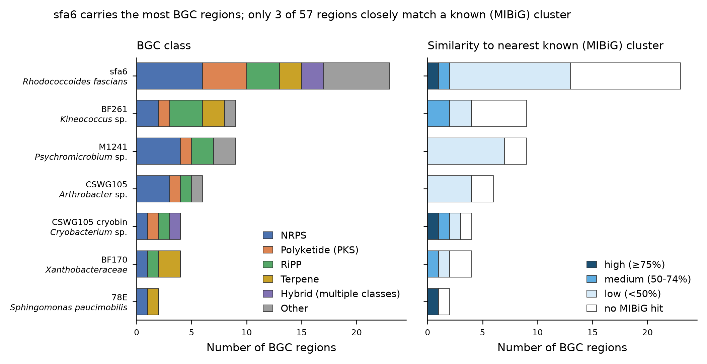
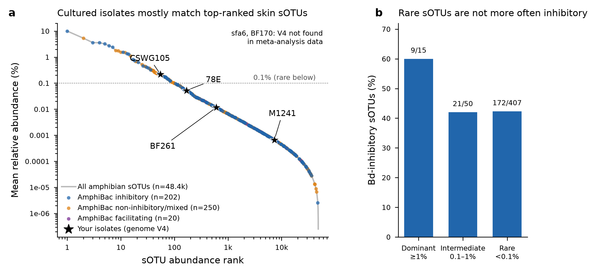
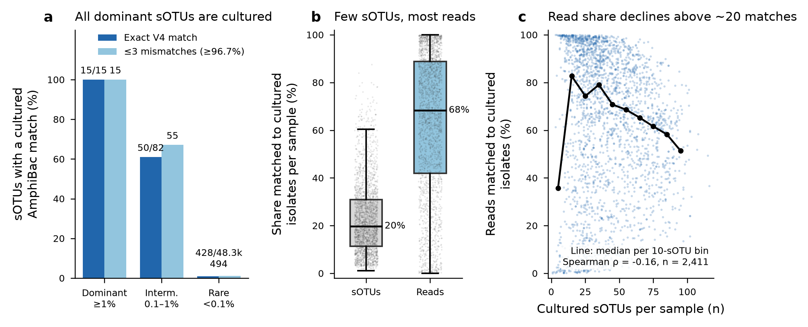
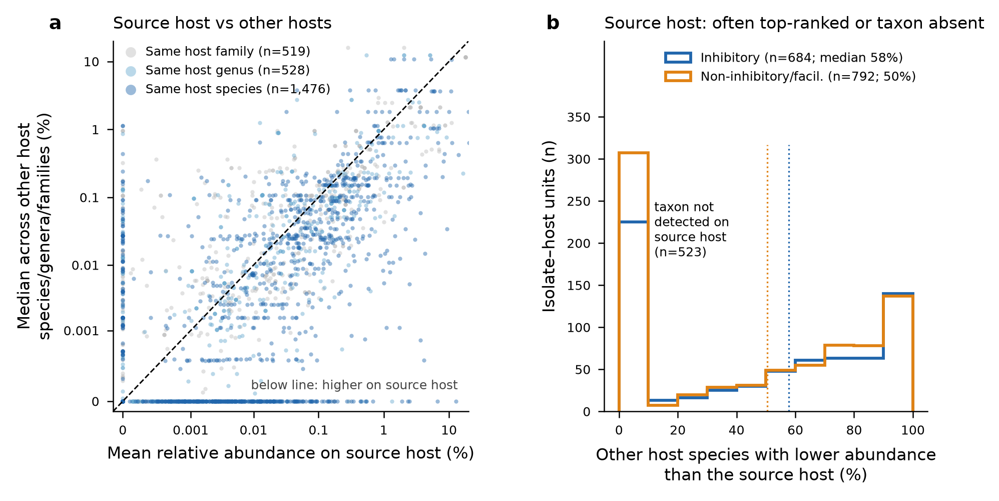
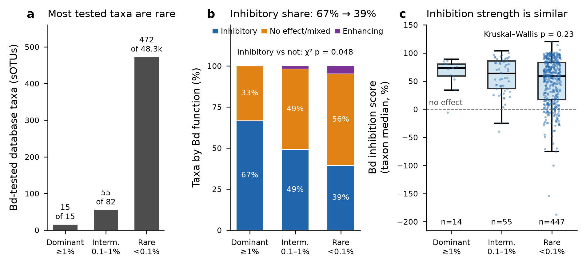
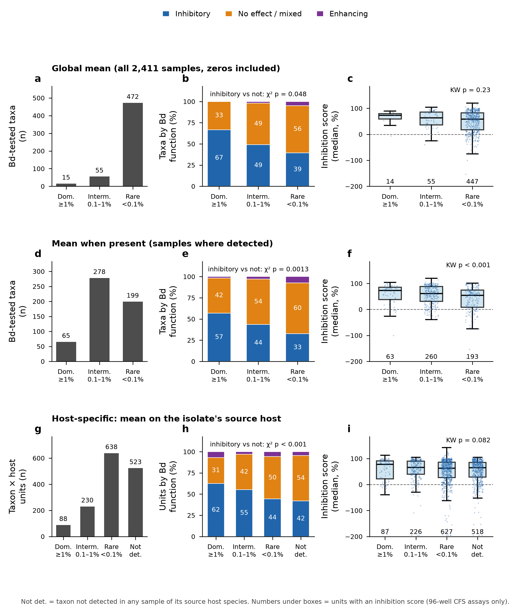
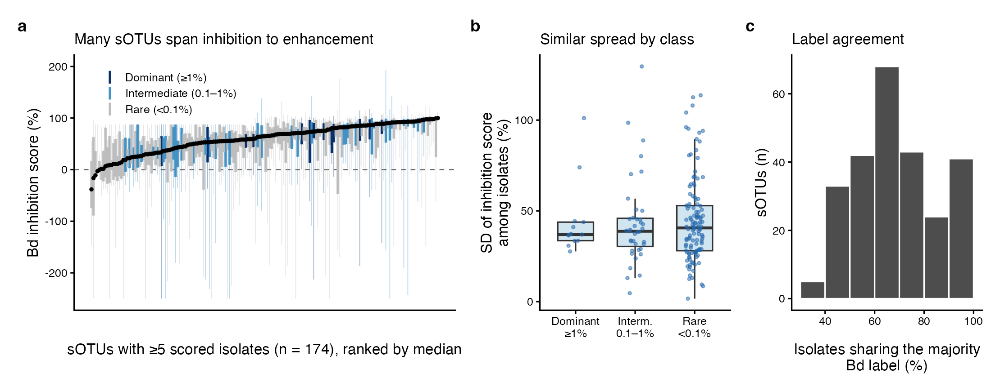
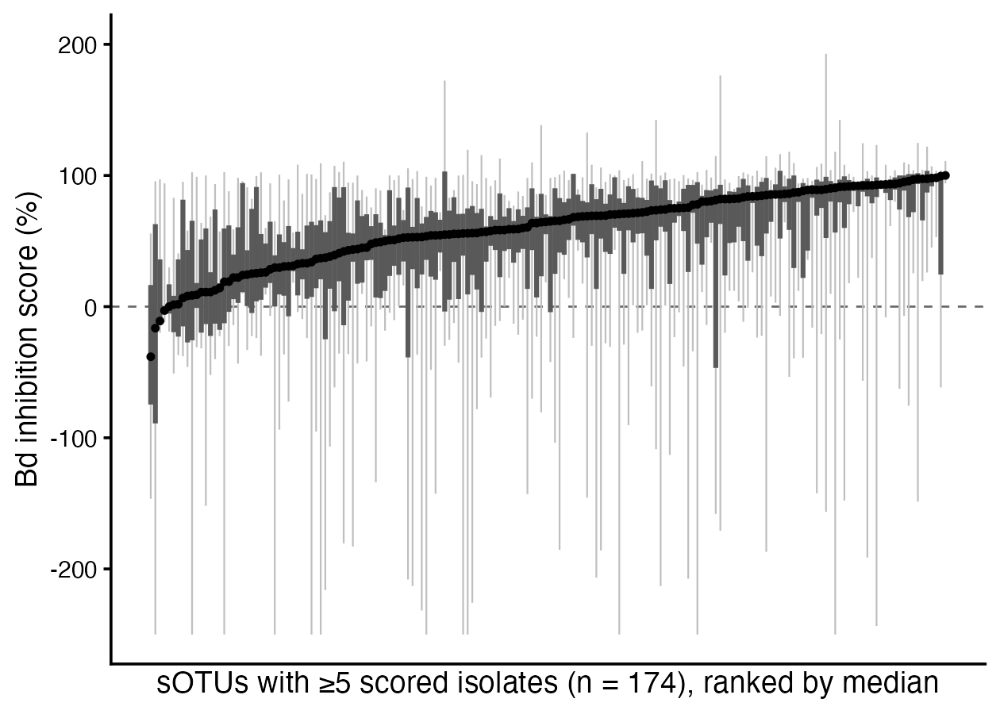
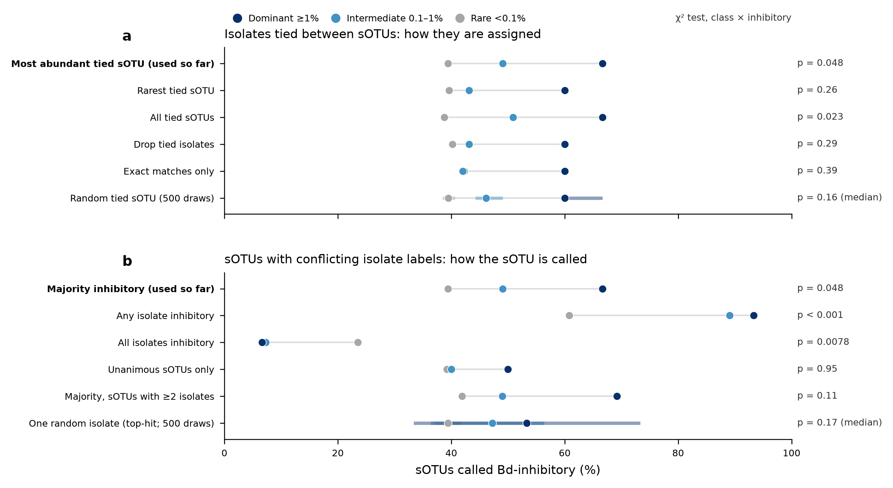

# Project summary: Bd-inhibitory bullfrog skin isolates as rare / novel taxa
*Status as of 2026-11-02. All numbers come from the files linked below (paths are relative to the repository root).*

## Key conclusions
1. **Most of the isolates are new or little-known taxa.** Five of the seven genomes are probable new species: BF3 (*Kineococcus*), BF6 (*Psychromicrobium*), BF5 (*Arthrobacter*), BF4 (*Cryobacterium*), and BF2, which may be a new Xanthobacteraceae genus. BF7 (*Rhodococcoides fascians*) and BF1 (*Sphingomonas paucimobilis*) belong to known species.
2. **Their biosynthetic potential is largely uncharacterised.** antiSMASH found 57 regions, and only 3 reach ≥75% similarity to a known MIBiG cluster.
3. **They are rare on amphibian skin.** Their V4 sequences make up at most 0.22% mean relative abundance in the meta-analysis, and BF7 and BF2 are absent. *Rhodococcoides* and *Psychromicrobium* are essentially undetected in the meta-analysis, bullfrog and salamander data.
4. **They are an exception to the database-wide pattern.** In AmphiBac, cultured isolates mostly match abundant sOTUs (15/15 dominant sOTUs have a cultured match), and rare taxa are not more often Bd-inhibitory than dominant ones (sections 6 and 8).
5. **Inhibition is a strain-level trait.** Isolates sharing a V4 sOTU differ widely in Bd inhibition (median within-sOTU SD 39.6 points; 74.7% of sOTUs contain both strong inhibitors and enhancers), and the sOTU explains only about 15% of the variance in inhibition score (section 7).

## Repository layout
| Path | Contents |
|---|---|
| [outputs/](outputs/) | Result tables and figures, one folder per analysis (01 MiGA … 07 panel A) |
| [code/amphib_R/](code/amphib_R/) | R pipeline for the meta-analysis, bullfrog and AmphiBac analyses (see its README) |
| [code/multihit_sensitivity.py](code/multihit_sensitivity.py) | Multi-hit sensitivity analysis (section 8) |
| [code/sOTU_Bd_panelA/](code/sOTU_Bd_panelA/) | Stand-alone data, script and methods for panel A |
| [code/session_log/](code/session_log/) | Every code cell run during the analysis, in order, with an index |
| [aggregated_genomes/](aggregated_genomes/), [Prokka/](Prokka/), [gff_files/](gff_files/) | Genome assemblies and Prokka annotations for BF1–BF7 |

## 1. Goal
Bacteria cultured from bullfrog (*Lithobates catesbeianus*) skin inhibit *Batrachochytrium dendrobatidis* (Bd) at about 100% in vitro. The aim is to show that these isolates (i) are undescribed or poorly known taxa, (ii) are rare or absent in amphibian skin amplicon surveys, and (iii) carry novel biosynthetic potential. They are set against the background of the AmphiBac isolate database and the amphibian skin microbiome meta-analysis.

## 2. Genome taxonomy (MiGA, TypeMat)
Tables: [MiGA_isolate_summary_7.xlsx](outputs/01_MiGA_taxonomy/MiGA_isolate_summary_7.xlsx) (7 genomes). All genomes were rated Excellent quality by MiGA (100% complete, ≤4.3% contamination).

| Isolate | Closest type genome | Metric | Interpretation |
|---|---|---|---|
| BF7 | *Rhodococcoides fascians* DSM 43673 | ANI 98.05% | *R. fascians* (≥95% ANI; MiGA's p-value call says "novel species") |
| BF3 | *Kineococcus rhizosphaerae* DSM 19711 | AAI 74.21% | *Kineococcus* sp. nov. |
| BF6 | *Psychromicrobium lacuslunae* IHBB 11108 | ANI 83.30% | *Psychromicrobium* sp. nov. |
| BF5 | *Arthrobacter humicola* JCM 15921 | ANI 88.16% | *Arthrobacter* sp. nov. |
| BF4 | *Cryobacterium soli* GCJ02 | ANI 90.97% | *Cryobacterium* sp. nov.; binned from the same culture as BF5 (different family); no 16S gene recovered |
| BF2 | *Ancylobacter pratisalsi* DSM 102029 | AAI 70.15% | Xanthobacteraceae, possibly a new genus |
| BF1 | *Sphingomonas paucimobilis* | ANI 99.49% | *S. paucimobilis*; contaminant *Bacillus* 16S on one low-coverage contig (NODE_103) |

Taxonomy note: *Rhodococcoides* is the recent split of *R. fascians*, *R. corynebacterioides*, *R. kroppenstedtii*, *R. kyotonensis*, *R. navarretei*, *R. trifolii*, *R. yunnanensis* and *R. luteus* from *Rhodococcus*. Older 16S databases still label these as *Rhodococcus*.

## 3. Biosynthetic potential (antiSMASH 7.1.0, relaxed)
Files: [antiSMASH_BGC_summary.xlsx](outputs/02_antiSMASH/antiSMASH_BGC_summary.xlsx), [antiSMASH_regions.csv](outputs/02_antiSMASH/antiSMASH_regions.csv), and one full-result zip per genome.
- There are 57 regions in total: BF7 23, BF3 9, BF6 9, BF5 6, BF4 4, BF2 4, BF1 2.
- Only 3 regions reach ≥75% similarity to a known MIBiG cluster: ε-poly-L-lysine in BF7 and in BF4, and zeaxanthin in BF1. Most regions are below 50%, i.e. potentially novel.
- BF5 and BF4 (binned from the same culture) share NAPAA, T3PKS and betalactone region types.

*BGC regions per genome by class (left) and by similarity to the nearest MIBiG cluster (right).*

## 4. Target genera in amplicon data
### 4a. Meta-analysis
2,411 samples with ≥1,000 reads. Methods: BLAST (≥97%) and exact V4 match against NCBI 16S references for 11 genera. Files: [amphibian_genus_abundance.xlsx](outputs/03_genus_abundance/meta_analysis/amphibian_genus_abundance.xlsx), per-sample [amphibian_genus_relabund_by_sample.csv](outputs/03_genus_abundance/meta_analysis/amphibian_genus_relabund_by_sample.csv).
- *Sphingomonas*: present in 80.9% of samples (mean 0.78%). *Arthrobacter* 41.7%, *Rhodococcus* 32.4%, *Kineococcus* 14.4%, *Ancylobacter* 13.7%.
- *Rhodococcoides* and *Psychromicrobium*: no sOTU has a BLAST top hit to either genus. The exact V4 matches that exist are shared with *Rhodococcus* or *Arthrobacter*.
- *Cryobacterium*: exact-V4 prevalence is 23.9%, falling to 16.9% when at least 2 supporting reference records are required.

### 4b. Bullfrog dataset
42 samples, 3,700 ASVs of 120 bp; P10F3 and P4F1 were dropped for having <1,000 reads. Files: [bullfrog_genus_abundance.xlsx](outputs/03_genus_abundance/bullfrog/bullfrog_genus_abundance.xlsx), [ASV_target_genus_matches.xlsx](outputs/03_genus_abundance/bullfrog/ASV_target_genus_matches.xlsx).
- *Sphingomonas*: 0.93–1.42%, in 100% of samples. *Ancylobacter* about 0.08%.
- *Rhodococcoides* candidate (ASV 5cb28bd0; tied with *Antrihabitans*/*Rhodococcus*): 0.04%, in 50% of samples.
- *Kineococcus* 0.01–0.03%; *Arthrobacter* 0.008%.
- Not detected: *Psychromicrobium*. The *Cryobacterium* signal rests only on single-record matches and is likely spurious.

### 4c. Red-backed salamander (RBS1–15)
File: [salamander_genus_abundance.xlsx](outputs/03_genus_abundance/salamander/salamander_genus_abundance.xlsx).
- *Sphingomonas* 0.80% (part of this signal has BLAST top hits to *Parasphingomonas*). *Ancylobacter* 0.11%, in 53% of samples.
- Not detected: *Rhodococcoides*, *Psychromicrobium* and *Kineococcus*.

### 4d. The isolates' own V4 sequences (from the genomes) in the meta-analysis
- BF5: 0.22% (rank 55). BF1: 0.052%. BF3: 0.012%. BF6: 0.0007%.
- Absent: BF7 and BF2.
- AmphiBac isolates that share BF7's V4 are mostly non-inhibitory (19 of 28). All 3 that share BF3's V4 are non-inhibitory.

## 5. AmphiBac 2025.1 (tested) vs the meta-analysis
Isolates were matched to sOTUs by exact containment of the 90-bp sOTU in the isolate 16S, otherwise by ≤3 mismatches over the V4 window (allowing for Sanger error). Files: [AmphiBac_meta_abundance.xlsx](outputs/04_AmphiBac_vs_meta/AmphiBac_meta_abundance.xlsx), [AmphiBac_near_matches.xlsx](outputs/04_AmphiBac_vs_meta/AmphiBac_near_matches.xlsx).
- **Matching:** 6,610 of the 6,729 V4-spanning isolates match an sOTU with reads. 1,144 isolates lack V4 coverage (median length 488 bp).
- **Cultured share by abundance class:** 15/15 dominant, 55/82 intermediate, 494/48.3k rare sOTUs have a cultured representative. Per sample, cultured sOTUs are a median 20% of sOTUs but 68% of reads.
- **Detected vs undetected isolates:** inhibition rates are similar, 49% vs 43% (p = 0.32).

*(a) Rank abundance of all meta-analysis sOTUs, with AmphiBac-matched sOTUs coloured by Bd function and the BF isolates marked. (b) Share of Bd-inhibitory sOTUs by abundance class.*

*(a) sOTUs with a cultured AmphiBac match by abundance class. (b) Per-sample share of sOTUs and reads matched to cultured isolates. (c) Read share vs number of matched sOTUs per sample.*

**Source host** ([AmphiBac_source_host_abundance.xlsx](outputs/04_AmphiBac_vs_meta/AmphiBac_source_host_abundance.xlsx)):
- Isolates are usually less abundant on the host species they were cultured from than elsewhere: the source host is higher in only 26% of the 1,626 sOTU × host units (pooled).
- Host by host (1,476 units), the source host ranks above a median 54% of other host species.
- The taxon is absent on its source host in 35% of units, and the source host is the top host only 40 times.

*(a) Abundance on the source host vs other hosts. (b) Share of other host species with lower abundance than the source host.*

## 6. Abundance class vs Bd function
Classes: dominant ≥1%, intermediate 0.1–1%, rare <0.1%. Files: [AmphiBac_abundance_class_function.xlsx](outputs/04_AmphiBac_vs_meta/AmphiBac_abundance_class_function.xlsx), [AmphiBac_abundance_class_definitions.xlsx](outputs/04_AmphiBac_vs_meta/AmphiBac_abundance_class_definitions.xlsx).

| Definition | n (D / I / R) | % inhibitory (D / I / R) | p (χ²) |
|---|---|---|---|
| Global mean, taxa | 15 / 55 / 472 | 67 / 49 / 39 | 0.048 |
| Global mean, isolates | 1,017 / 1,797 / 3,158 | 68 / 52 / 40 | (inflated, non-independent) |
| Mean when present, taxa | 65 / 278 / 199 | 57 / 44 / 33 | 0.0013 |
| Host-specific (59 hosts; + 523 not detected) | 88 / 230 / 638 | 62 / 55 / 44 (not detected 42) | 0.0004 |

**Conclusion:** under every definition, rare taxa are *less* often Bd-inhibitory, not more. Framing for the paper: the BF isolates are an exception to the database-wide trend. They are rare or undetected yet strongly inhibitory, which shows that inhibition is a strain-level trait not predictable from 16S.

*Bd-tested taxa by global abundance class: (a) counts, (b) Bd function, (c) inhibition score.*

*The same comparison under three abundance-class definitions: global mean, mean when present, and mean on the source host.*

## 7. Variation in Bd inhibition within each sOTU
Score = (1 − proportional Bd growth) × 100, from 96-well cell-free supernatant (CFS) assays only. Current values, after restricting to the three Bd labels:
- **Spread:** 174 sOTUs have ≥5 scored isolates (4,551 isolates, 16 studies). The median within-sOTU SD is 39.6 points.
- **Opposite effects:** 74.7% of sOTUs contain both an isolate scoring >50 and one scoring <0 (enhancing Bd growth).
- **No class effect:** median SD by class is 37.0 / 38.8 / 40.6 (Kruskal–Wallis p = 0.92).
- **Label agreement** (sOTUs with ≥3 isolates): a median of 67% of isolates share the majority label, and 13% of sOTUs are unanimous.
- **Variance partitioning:** sOTU explains 0.15 of the variance (ICC), study 0.23, and sOTU × study 0.39. 30% of the 146 multi-study sOTUs show a significant study effect.

Current values from the rebuilt R project (script 05). Earlier saved versions of these three files predated the Bd-label filter and showed 175 sOTUs, 11% unanimous and 29% of 147; the current versions are linked here: [sOTU_Bd_function_variance.csv](outputs/06_within_sOTU_Bd_variance/sOTU_Bd_function_variance.csv), [Bd_variance_partitioning.csv](outputs/06_within_sOTU_Bd_variance/Bd_variance_partitioning.csv), [sOTU_Bd_variance.png](outputs/06_within_sOTU_Bd_variance/sOTU_Bd_variance.png).

*(a) Per-sOTU spread of Bd inhibition scores (174 sOTUs with ≥5 scored isolates). (b) SD by abundance class. (c) Share of isolates sharing the majority label.*

**Panel A, packaged for the separate manuscript:** [sOTU_Bd_panelA.zip](outputs/07_panelA_separate_manuscript/sOTU_Bd_panelA.zip) (data, R script, figure, methods; abundance colouring removed).

*Panel A as packaged for the separate manuscript (no abundance colouring).*

## 8. Multi-hit sensitivity of the abundance-class results
Files: [AmphiBac_multihit_sensitivity.xlsx](outputs/05_multihit_sensitivity/AmphiBac_multihit_sensitivity.xlsx), figure [AmphiBac_multihit_sensitivity.png](outputs/05_multihit_sensitivity/AmphiBac_multihit_sensitivity.png); script [code/multihit_sensitivity.py](code/multihit_sensitivity.py).

*% of sOTUs called inhibitory by abundance class under alternative rules for (a) isolates tied between sOTUs and (b) sOTUs with conflicting isolate labels; χ² p-values at right.*

- **Isolate side:** 852 of the 5,972 matched Bd-tested isolates (14%) have no exact match and are tied between several nearest sOTUs (median 5). No isolate exactly contains more than one sOTU. The original "most abundant tied sOTU" rule placed 229 isolates in the dominant or intermediate class that a "rarest" rule would call rare.
- **sOTU side:** 75.5% of sOTUs with ≥2 isolates have conflicting Bd labels (dominant 13/13, intermediate 45/49, rare 189/265).
- **Taxon-level χ² (p = 0.048):** significant only under the most-abundant rule (0.048) or the all-tied rule (0.023). It is not significant with rarest-tied (0.26), drop-tied (0.29), exact-only (0.39) or random tie-breaking (median 0.16).
- **Direction:** dominant ≥ rare under every tie rule and under the majority, unanimous and random-isolate label rules. The exception is the "all isolates inhibitory" label rule, where rare > dominant (23.5% vs 6.7%, p = 0.008). That reversal reflects isolate count: an sOTU with 19 isolates rarely has all of them inhibitory.
- **Label rules:** "any isolate inhibitory" and "all isolates inhibitory" are confounded by isolate count (median 19 per dominant sOTU vs 2 per rare sOTU).
- **Robust to every rule:** isolate-level inhibitory share (68–69 / 51–52 / 40–41%), cultured share (dominant always 15/15), and a weak positive correlation between abundance and median score (ρ 0.12–0.14, p ≤ 0.009).
- **Manuscript wording:** "rare taxa are not more often inhibitory" stands; describe the dominant > rare gradient as a trend that is sensitive to how multi-hits are resolved.

## 9. Decisions recorded
- AmphiBac matching uses ≤3 mismatches over V4 (chosen to allow for Sanger sequencing error).
- Taxon-level p-values are the conservative ones; isolate-level tests are inflated by non-independence.
- Genome and salamander analyses are kept out of the R package.

## 10. Open items
1. **R project (`amphib_R`)**: rebuilt on 2026-11-02 by replaying the recorded session code; it is in [code/amphib_R/](code/amphib_R/) (see its README for the input files to add). All outputs match the earlier results. The one exception is the *Arthrobacter* strictest-method count (unique to one genus, ≥2 references) in the bullfrog data: 0 ASVs vs 1 in the saved workbook, because the exact match is shared with *Paeniglutamicibacter*. The 16S BLAST was re-run against the 29 Oct 2026 NCBI release (27,646 sequences) with identical BLAST-based results.
2. The optional NCBI re-download script timed out against NCBI E-utilities and is untested. The reference sequences used are saved in [code/amphib_R/data/raw/ncbi_refs/](code/amphib_R/data/raw/ncbi_refs/).
3. Not re-checked for multi-hit sensitivity: the mean-when-present and host-specific class definitions and the source-host analysis, which use the same most-abundant tie rule.
4. Offered but not run: the ≥2-record *Cryobacterium* filter for the per-sample meta-analysis files, and bullfrog-only abundance classes.
