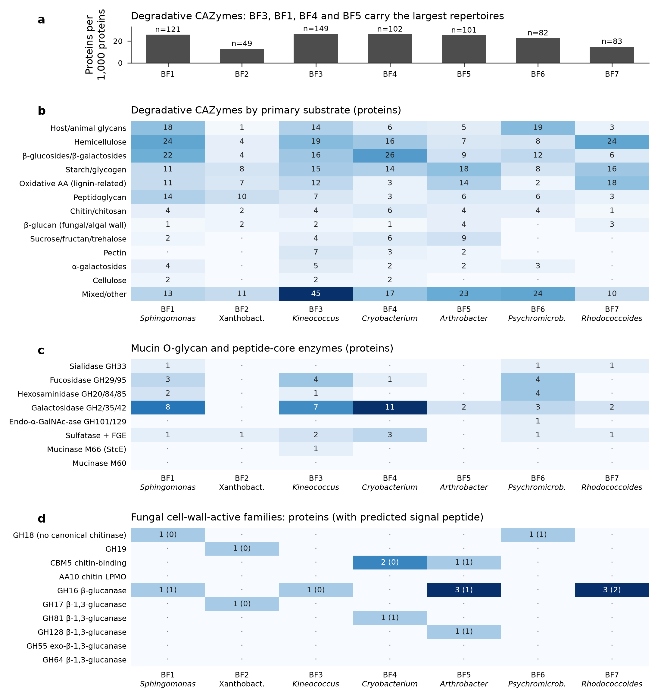
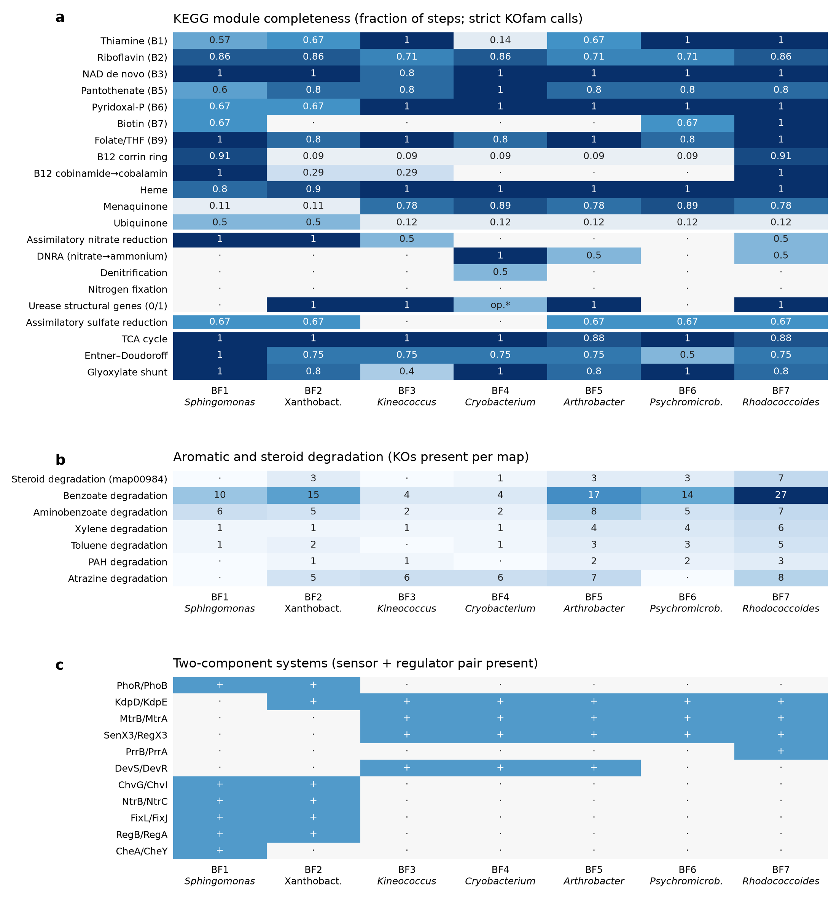
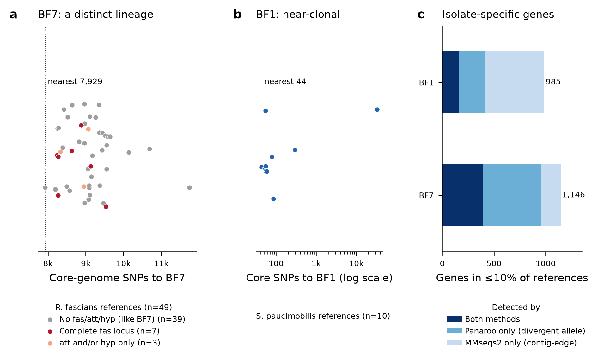
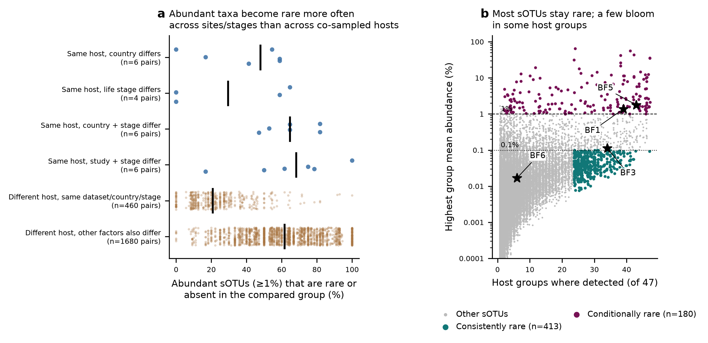
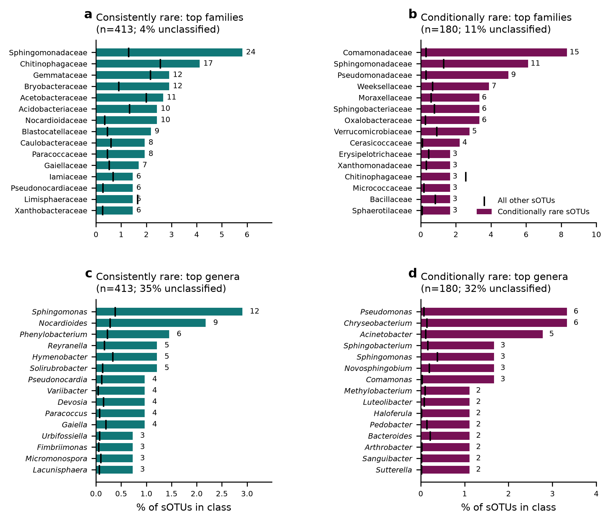
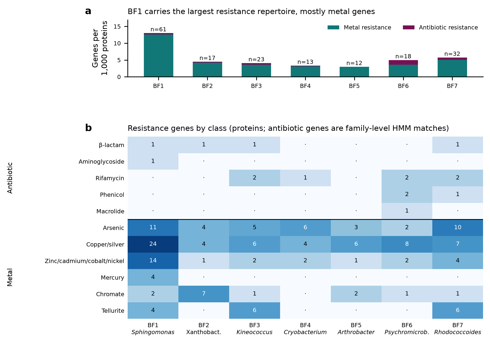
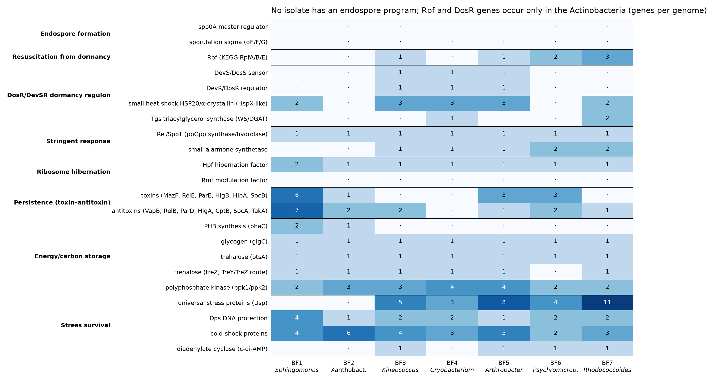

# Project summary: Bd-inhibitory bullfrog skin isolates as rare / novel taxa
*Status as of 2026-11-02. All numbers come from the files linked below (paths are relative to the repository root).*

## Key conclusions
1. **Most of the isolates are new or little-known taxa.** Five of the seven genomes are probable new species: BF3 (*Kineococcus*), BF6 (*Psychromicrobium*), BF5 (*Arthrobacter*), BF4 (*Cryobacterium*), and BF2, which may be a new Xanthobacteraceae genus. BF7 (*Rhodococcoides fascians*) and BF1 (*Sphingomonas paucimobilis*) belong to known species.
2. **Their biosynthetic potential is largely uncharacterised.** antiSMASH found 57 regions, and only 3 reach ≥75% similarity to a known MIBiG cluster.
3. **They are rare on amphibian skin.** Their V4 sequences make up at most 0.22% mean relative abundance in the meta-analysis, and BF7 and BF2 are absent. *Rhodococcoides* and *Psychromicrobium* are essentially undetected in the meta-analysis, bullfrog and salamander data.
4. **They are an exception to the database-wide pattern.** In AmphiBac, cultured isolates mostly match abundant sOTUs (15/15 dominant sOTUs have a cultured match), and rare taxa are not more often Bd-inhibitory than dominant ones (sections 6 and 8).
5. **Inhibition is a strain-level trait.** Isolates sharing a V4 sOTU differ widely in Bd inhibition (median within-sOTU SD 39.6 points; 74.7% of sOTUs contain both strong inhibitors and enhancers), and the sOTU explains only about 15% of the variance in inhibition score (section 7).
6. **The genomes point to secondary metabolism rather than cell-wall enzymes.** No isolate carries a canonical chitinase. BF7 is a non-pathogenic, distinct *R. fascians* lineage with novel biosynthetic islands, and the isolates differ in B12, biotin, urease and nitrogen capacity (section 9).
7. **No isolate carries vertebrate steroid-hormone synthesis genes.** None has the testosterone/progesterone genes from Mohamed et al. 2026; BF7 has only the first steroid-breakdown steps. The leads are a possible corticosteroid-modifying 3α/20β-HSD in BF4/BF5, ACC deaminase and GABA synthesis (section 10).
8. **Rarity on amphibian skin depends more on context than on host.** 413 sOTUs are consistently rare (mostly soil oligotrophs) and 180 conditionally rare (mostly bloom-forming Proteobacteria/Bacteroidota). Abundant sOTUs drop out more often across sites, stages or studies of the same host than between co-sampled host species. BF1 and BF5 are conditionally rare; BF3 is almost consistently rare (section 11).
9. **No acquired antibiotic resistance; BF1 stands out for metal resistance.** All 16 antibiotic-resistance calls are intrinsic-type, family-level matches. BF1 carries 59 metal-resistance genes (copper/silver, cobalt/zinc/cadmium, arsenic, mercury), and many of them are BF1-specific islands absent from public *S. paucimobilis* (section 12).
10. **None forms endospores; the Actinobacteria have a mycobacterial-type dormancy toolkit.** BF3–BF7 carry Rpf resuscitation factors and/or the DosR regulon, Tgs and many universal stress proteins. BF1 and BF2 rely instead on PHB storage, and BF1 also on toxin–antitoxin modules (section 13).

## Repository layout
| Path | Contents |
|---|---|
| [outputs/](outputs/) | Result tables and figures, one folder per analysis (01 MiGA … 07 panel A) |
| [code/amphib_R/](code/amphib_R/) | R pipeline for the meta-analysis, bullfrog and AmphiBac analyses (see its README) |
| [code/multihit_sensitivity.py](code/multihit_sensitivity.py) | Multi-hit sensitivity analysis (section 8) |
| [code/sOTU_Bd_panelA/](code/sOTU_Bd_panelA/) | Stand-alone data, script and methods for panel A |
| [code/session_log/](code/session_log/) | Every code cell run during the analysis, in order, with an index |
| [outputs/08_functional_genomics/](outputs/08_functional_genomics/) | CAZyme/mucin, KEGG and comparative-genomics results (section 9) |
| [code/functional_genomics/](code/functional_genomics/) | Scripts for the functional-genomics screens |
| [outputs/09_hormone_screen/](outputs/09_hormone_screen/) | Steroid (Mohamed et al. 2026) and hormone-related KO tables (section 10) |
| [code/hormone_KO_screen/](code/hormone_KO_screen/) | Script for section 10 |
| [outputs/10_conditional_rarity/](outputs/10_conditional_rarity/) | Consistently vs conditionally rare sOTUs, taxonomy of both classes (section 11) |
| [code/conditional_rarity/](code/conditional_rarity/) | Scripts for section 11 |
| [outputs/11_resistance/](outputs/11_resistance/) | Antibiotic and metal resistance genes (section 12) |
| [code/resistance_screen/](code/resistance_screen/) | AMRFinderPlus run and table/figure scripts for section 12 |
| [outputs/12_dormancy/](outputs/12_dormancy/) | Dormancy-related genes (section 13) |
| [code/dormancy_screen/](code/dormancy_screen/) | Script for section 13 |
| [aggregated_genomes/](aggregated_genomes/), [Prokka/](Prokka/), [gff_files/](gff_files/) | Genome assemblies and Prokka annotations for BF1–BF7 |

## 1. Goal
Bacteria cultured from bullfrog (*Lithobates catesbeianus*) skin inhibit *Batrachochytrium dendrobatidis* (Bd) at about 100% in vitro. The aim is to show that these isolates (i) are undescribed or poorly known taxa, (ii) are rare or absent in amphibian skin amplicon surveys, and (iii) carry novel biosynthetic potential. They are set against the background of the AmphiBac isolate database and the amphibian skin microbiome meta-analysis.

## 2. Genome taxonomy (MiGA, TypeMat)
Tables: [MiGA_isolate_summary_7.xlsx](outputs/01_MiGA_taxonomy/MiGA_isolate_summary_7.xlsx) (7 genomes). All genomes were rated Excellent quality by MiGA (100% complete, ≤4.3% contamination).

| Isolate | Closest type genome | Metric | Interpretation |
|---|---|---|---|
| BF7 | *Rhodococcoides fascians* DSM 43673 | ANI 98.05% | *R. fascians* (≥95% ANI; MiGA's p-value call says "novel species") |
| BF3 | *Kineococcus rhizosphaerae* DSM 19711 | AAI 74.21% | *Kineococcus* sp. nov. |
| BF6 | *Psychromicrobium lacuslunae* IHBB 11108 | ANI 83.30% | *Psychromicrobium* sp. nov. |
| BF5 | *Arthrobacter humicola* JCM 15921 | ANI 88.16% | *Arthrobacter* sp. nov. |
| BF4 | *Cryobacterium soli* GCJ02 | ANI 90.97% | *Cryobacterium* sp. nov. |
| BF2 | *Ancylobacter pratisalsi* DSM 102029 | AAI 70.15% | Xanthobacteraceae, possibly a new genus |
| BF1 | *Sphingomonas paucimobilis* | ANI 99.49% | *S. paucimobilis*; contaminant *Bacillus* 16S on one low-coverage contig (NODE_103) |

Taxonomy note: *Rhodococcoides* is the recent split of *R. fascians*, *R. corynebacterioides*, *R. kroppenstedtii*, *R. kyotonensis*, *R. navarretei*, *R. trifolii*, *R. yunnanensis* and *R. luteus* from *Rhodococcus*. Older 16S databases still label these as *Rhodococcus*.

## 3. Biosynthetic potential (antiSMASH 7.1.0, relaxed)
Files: [antiSMASH_BGC_summary.xlsx](outputs/02_antiSMASH/antiSMASH_BGC_summary.xlsx), [antiSMASH_regions.csv](outputs/02_antiSMASH/antiSMASH_regions.csv), and one full-result zip per genome.
- There are 57 regions in total: BF7 23, BF3 9, BF6 9, BF5 6, BF4 4, BF2 4, BF1 2.
- Only 3 regions reach ≥75% similarity to a known MIBiG cluster: ε-poly-L-lysine in BF7 and in BF4, and zeaxanthin in BF1. Most regions are below 50%, i.e. potentially novel.
- BF5 and BF4 (binned from the same culture) share NAPAA, T3PKS and betalactone region types.


*BGC regions per genome by class (left) and by similarity to the nearest MIBiG cluster (right).*

## 4. Target genera in amplicon data
### 4a. Meta-analysis
2,411 samples with ≥1,000 reads. Methods: BLAST (≥97%) and exact V4 match against NCBI 16S references for 11 genera. Files: [amphibian_genus_abundance.xlsx](outputs/03_genus_abundance/meta_analysis/amphibian_genus_abundance.xlsx), per-sample [amphibian_genus_relabund_by_sample.csv](outputs/03_genus_abundance/meta_analysis/amphibian_genus_relabund_by_sample.csv).
- *Sphingomonas*: present in 80.9% of samples (mean 0.78%). *Arthrobacter* 41.7%, *Rhodococcus* 32.4%, *Kineococcus* 14.4%, *Ancylobacter* 13.7%.
- *Rhodococcoides* and *Psychromicrobium*: no sOTU has a BLAST top hit to either genus. The exact V4 matches that exist are shared with *Rhodococcus* or *Arthrobacter*.
- *Cryobacterium*: exact-V4 prevalence is 23.9%, falling to 16.9% when at least 2 supporting reference records are required.

### 4b. Bullfrog dataset
42 samples, 3,700 ASVs of 120 bp; P10F3 and P4F1 were dropped for having <1,000 reads. Files: [bullfrog_genus_abundance.xlsx](outputs/03_genus_abundance/bullfrog/bullfrog_genus_abundance.xlsx), [ASV_target_genus_matches.xlsx](outputs/03_genus_abundance/bullfrog/ASV_target_genus_matches.xlsx).
- *Sphingomonas*: 0.93–1.42%, in 100% of samples. *Ancylobacter* about 0.08%.
- *Rhodococcoides* candidate (ASV 5cb28bd0; tied with *Antrihabitans*/*Rhodococcus*): 0.04%, in 50% of samples.
- *Kineococcus* 0.01–0.03%; *Arthrobacter* 0.008%.
- Not detected: *Psychromicrobium*. The *Cryobacterium* signal rests only on single-record matches and is likely spurious.

### 4c. Red-backed salamander (RBS1–15)
File: [salamander_genus_abundance.xlsx](outputs/03_genus_abundance/salamander/salamander_genus_abundance.xlsx).
- *Sphingomonas* 0.80% (part of this signal has BLAST top hits to *Parasphingomonas*). *Ancylobacter* 0.11%, in 53% of samples.
- Not detected: *Rhodococcoides*, *Psychromicrobium* and *Kineococcus*.

### 4d. The isolates' own V4 sequences (from the genomes) in the meta-analysis
- BF5: 0.22% (rank 55). BF1: 0.052%. BF3: 0.012%. BF6: 0.0007%.
- Absent: BF7 and BF2.
- AmphiBac isolates that share BF7's V4 are mostly non-inhibitory (19 of 28). All 3 that share BF3's V4 are non-inhibitory.

## 5. AmphiBac 2025.1 (tested) vs the meta-analysis
Isolates were matched to sOTUs by exact containment of the 90-bp sOTU in the isolate 16S, otherwise by ≤3 mismatches over the V4 window (allowing for Sanger error). Files: [AmphiBac_meta_abundance.xlsx](outputs/04_AmphiBac_vs_meta/AmphiBac_meta_abundance.xlsx), [AmphiBac_near_matches.xlsx](outputs/04_AmphiBac_vs_meta/AmphiBac_near_matches.xlsx).
- **Matching:** 6,610 of the 6,729 V4-spanning isolates match an sOTU with reads. 1,144 isolates lack V4 coverage (median length 488 bp).
- **Cultured share by abundance class:** 15/15 dominant, 55/82 intermediate, 494/48.3k rare sOTUs have a cultured representative. Per sample, cultured sOTUs are a median 20% of sOTUs but 68% of reads.
- **Detected vs undetected isolates:** inhibition rates are similar, 49% vs 43% (p = 0.32).


*(a) Rank abundance of all meta-analysis sOTUs, with AmphiBac-matched sOTUs coloured by Bd function and the BF isolates marked. (b) Share of Bd-inhibitory sOTUs by abundance class.*


*(a) sOTUs with a cultured AmphiBac match by abundance class. (b) Per-sample share of sOTUs and reads matched to cultured isolates. (c) Read share vs number of matched sOTUs per sample.*

**Source host** ([AmphiBac_source_host_abundance.xlsx](outputs/04_AmphiBac_vs_meta/AmphiBac_source_host_abundance.xlsx)):
- Isolates are usually less abundant on the host species they were cultured from than elsewhere: the source host is higher in only 26% of the 1,626 sOTU × host units (pooled).
- Host by host (1,476 units), the source host ranks above a median 54% of other host species.
- The taxon is absent on its source host in 35% of units, and the source host is the top host only 40 times.


*(a) Abundance on the source host vs other hosts. (b) Share of other host species with lower abundance than the source host.*

## 6. Abundance class vs Bd function
Classes: dominant ≥1%, intermediate 0.1–1%, rare <0.1%. Files: [AmphiBac_abundance_class_function.xlsx](outputs/04_AmphiBac_vs_meta/AmphiBac_abundance_class_function.xlsx), [AmphiBac_abundance_class_definitions.xlsx](outputs/04_AmphiBac_vs_meta/AmphiBac_abundance_class_definitions.xlsx).

| Definition | n (D / I / R) | % inhibitory (D / I / R) | p (χ²) |
|---|---|---|---|
| Global mean, taxa | 15 / 55 / 472 | 67 / 49 / 39 | 0.048 |
| Global mean, isolates | 1,017 / 1,797 / 3,158 | 68 / 52 / 40 | (inflated, non-independent) |
| Mean when present, taxa | 65 / 278 / 199 | 57 / 44 / 33 | 0.0013 |
| Host-specific (59 hosts; + 523 not detected) | 88 / 230 / 638 | 62 / 55 / 44 (not detected 42) | 0.0004 |

**Conclusion:** under every definition, rare taxa are *less* often Bd-inhibitory, not more. Framing for the paper: the BF isolates are an exception to the database-wide trend. They are rare or undetected yet strongly inhibitory, which shows that inhibition is a strain-level trait not predictable from 16S.


*Bd-tested taxa by global abundance class: (a) counts, (b) Bd function, (c) inhibition score.*


*The same comparison under three abundance-class definitions: global mean, mean when present, and mean on the source host.*

## 7. Variation in Bd inhibition within each sOTU
Score = (1 − proportional Bd growth) × 100, from 96-well cell-free supernatant (CFS) assays only. Current values, after restricting to the three Bd labels:
- **Spread:** 174 sOTUs have ≥5 scored isolates (4,551 isolates, 16 studies). The median within-sOTU SD is 39.6 points.
- **Opposite effects:** 74.7% of sOTUs contain both an isolate scoring >50 and one scoring <0 (enhancing Bd growth).
- **No class effect:** median SD by class is 37.0 / 38.8 / 40.6 (Kruskal–Wallis p = 0.92).
- **Label agreement** (sOTUs with ≥3 isolates): a median of 67% of isolates share the majority label, and 13% of sOTUs are unanimous.
- **Variance partitioning:** sOTU explains 0.15 of the variance (ICC), study 0.23, and sOTU × study 0.39. 30% of the 146 multi-study sOTUs show a significant study effect.

Current values from the rebuilt R project (script 05). Earlier saved versions of these three files predated the Bd-label filter and showed 175 sOTUs, 11% unanimous and 29% of 147; the current versions are linked here: [sOTU_Bd_function_variance.csv](outputs/06_within_sOTU_Bd_variance/sOTU_Bd_function_variance.csv), [Bd_variance_partitioning.csv](outputs/06_within_sOTU_Bd_variance/Bd_variance_partitioning.csv), [sOTU_Bd_variance.png](outputs/06_within_sOTU_Bd_variance/sOTU_Bd_variance.png).


*(a) Per-sOTU spread of Bd inhibition scores (174 sOTUs with ≥5 scored isolates). (b) SD by abundance class. (c) Share of isolates sharing the majority label.*

**Panel A, packaged for the separate manuscript:** [sOTU_Bd_panelA.zip](outputs/07_panelA_separate_manuscript/sOTU_Bd_panelA.zip) (data, R script, figure, methods; abundance colouring removed).


*Panel A as packaged for the separate manuscript (no abundance colouring).*

## 8. Multi-hit sensitivity of the abundance-class results
Files: [AmphiBac_multihit_sensitivity.xlsx](outputs/05_multihit_sensitivity/AmphiBac_multihit_sensitivity.xlsx), figure [AmphiBac_multihit_sensitivity.png](outputs/05_multihit_sensitivity/AmphiBac_multihit_sensitivity.png); script [code/multihit_sensitivity.py](code/multihit_sensitivity.py).


*% of sOTUs called inhibitory by abundance class under alternative rules for (a) isolates tied between sOTUs and (b) sOTUs with conflicting isolate labels; χ² p-values at right.*

- **Isolate side:** 852 of the 5,972 matched Bd-tested isolates (14%) have no exact match and are tied between several nearest sOTUs (median 5). No isolate exactly contains more than one sOTU. The original "most abundant tied sOTU" rule placed 229 isolates in the dominant or intermediate class that a "rarest" rule would call rare.
- **sOTU side:** 75.5% of sOTUs with ≥2 isolates have conflicting Bd labels (dominant 13/13, intermediate 45/49, rare 189/265).
- **Taxon-level χ² (p = 0.048):** significant only under the most-abundant rule (0.048) or the all-tied rule (0.023). It is not significant with rarest-tied (0.26), drop-tied (0.29), exact-only (0.39) or random tie-breaking (median 0.16).
- **Direction:** dominant ≥ rare under every tie rule and under the majority, unanimous and random-isolate label rules. The exception is the "all isolates inhibitory" label rule, where rare > dominant (23.5% vs 6.7%, p = 0.008). That reversal reflects isolate count: an sOTU with 19 isolates rarely has all of them inhibitory.
- **Label rules:** "any isolate inhibitory" and "all isolates inhibitory" are confounded by isolate count (median 19 per dominant sOTU vs 2 per rare sOTU).
- **Robust to every rule:** isolate-level inhibitory share (68–69 / 51–52 / 40–41%), cultured share (dominant always 15/15), and a weak positive correlation between abundance and median score (ρ 0.12–0.14, p ≤ 0.009).
- **Manuscript wording:** "rare taxa are not more often inhibitory" stands; describe the dominant > rare gradient as a trend that is sensitive to how multi-hits are resolved.

## 9. Functional genomics of BF1–BF7
Full section, tables and methods: [outputs/08_functional_genomics/](outputs/08_functional_genomics/) (workbook [functional_genomics_BF1-BF7.xlsx](outputs/08_functional_genomics/functional_genomics_BF1-BF7.xlsx)). Gene presence means genetic capacity, not demonstrated activity.
- **Fungal cell wall:** no isolate encodes a canonical secreted chitinase or AA10 chitin LPMO. The only secreted β-1,3-glucanase candidates are GH16 in BF1, BF5 and BF7, GH81 in BF4 and GH128 in BF5. Direct enzymatic attack on the Bd wall is unlikely to explain inhibition in most isolates.
- **Mucin glycans:** the broadest O-glycan repertoires (sialidase, fucosidases, hexosaminidases) are in BF6, BF1 and BF3. BF6 alone has an endo-α-GalNAc-ase (GH101), and BF3 alone has a weak M66 mucinase hit. No complete sialic-acid or fucose catabolic cluster was found.
- **Metabolism:** only BF1 and BF7 can make B12 de novo. Biotin synthesis genes are absent at threshold in BF2–BF5. Urease occurs in BF2, BF3, BF5 and BF7, plus a near-threshold ureDGF-CBA cluster in BF4. Only BF4 has respiratory nitrate reductase.
- **Steroids:** BF7 carries the steroid-degradation genes (6 cholesterol oxidases, KstD, KshB). Whether it uses host sterols or glucocorticoids is untested.
- **BF7 vs public *R. fascians*:** BF7 is a non-pathogenic-type strain with no fas/att/hyp virulence genes (13 of 193 public genomes have complete fas). It is a distinct lineage (≥7,929 core SNPs to any reference) with 1,146 isolate-specific genes. These include a 135-kb RiPP/lanthipeptide-associated island and a PKS/NRPS hybrid island on plasmid-like contigs.
- **BF1 vs public *S. paucimobilis*:** BF1 is near-clonal with public genomes (44 core SNPs to FDAARGOS_881). Its 985 isolate-specific genes are mostly mobile/accessory content.


*Degradative CAZymes (a, b), mucin O-glycan enzymes (c) and fungal cell-wall-active families with predicted signal peptides (d).*


*KEGG module completeness (a), aromatic/steroid degradation KOs (b) and two-component systems (c).*


*Core-genome SNP distance of BF7 (a) and BF1 (b) to conspecific public genomes, and isolate-specific gene counts (c).*

## 10. Steroid and hormone genes (BF1–BF7)

**Method.** The KO calls come from the KofamScan 1.3.0 run in `outputs/08_functional_genomics` (KOfam profiles dated Oct 2026). A hit counts when it passes the KO-specific threshold.

**Steroid genes from Mohamed et al. 2026** (*Nat Microbiol*, doi:10.1038/s41564-026-02494-1; steroid hormones made by coral *Endozoicomonas*). The paper's 11 genes map to KOs as follows:

choD K03333, 17βHSD K05296, tesI K16051, ksi K01822, kstD K05898, kshA K15982, kshB K15983, hsaA K16047, hsaC K16049, hsaD K16050, fadD3 K18687.

| Gene | BF1 | BF2 | BF3 | BF4 | BF5 | BF6 | BF7 |
|---|---|---|---|---|---|---|---|
| choD | · | · | · | · | · | · | 6 |
| kstD | · | 1 | · | · | · | · | 1 |
| kshB | · | · | · | · | · | · | 1 |
| hsaA | · | 1 | · | · | · | · | · |
| 17βHSD, tesI, ksi, kshA, hsaC, hsaD, fadD3 | · | · | · | · | · | · | · |

- **No synthesis genes.** No isolate has the paper's testosterone/progesterone synthesis genes (17βHSD, tesI, ksi).
- **BF7 has only early breakdown steps.** It has cholesterol oxidase, kstD and kshB, but not kshA or the later ring-cleavage genes, so there is no complete steroid-degradation pathway.
- **Closest misses** (score/threshold): BF5 hsaA 0.91, BF7 fadD3 0.85, BF7 hsaD 0.82.
- **The 17βHSD near-misses are not evidence.** BF4's best K05296 hit is 0.89, but it comes from the large short-chain dehydrogenase family, which has many look-alike proteins.

**Wider hormone screen.** 136 KOs had definitions matching hormone or signalling terms. Hits at threshold (the full table in [outputs/09_hormone_screen/hormone_related_KOs_BF1-BF7.tsv](outputs/09_hormone_screen/hormone_related_KOs_BF1-BF7.tsv) also lists bile-acid transporters K03453/K14347 and the steroid hsaA/B subunits K16047/K16048):

| Group | KO | BF1 | BF2 | BF3 | BF4 | BF5 | BF6 | BF7 |
|---|---|---|---|---|---|---|---|---|
| 3α/20β-hydroxysteroid dehydrogenase (C20 of cortisol/progesterone) | K00038 | · | · | · | 2 | 1 | · | · |
| Bile salt hydrolase | K01442 | · | 1 | · | · | · | · | · |
| Bile acid–CoA ligase (baiB) | K15868 | · | · | 1 | · | · | · | · |
| ACC deaminase (ethylene) | K01505 | · | · | · | 1 | 1 | · | 1 |
| LOG (cytokinin release) | K22522 | 1 | 2 | 1 | · | · | · | 1 |
| tRNA-IPT miaA (housekeeping) | K00791 | 1 | 1 | 1 | 1 | 1 | 1 | 1 |
| Glutamate decarboxylase (GABA) | K01580 | · | · | · | 1 | 1 | 1 | 1 |
| Tyramine oxidase A/B | K25271/2 | 1 | · | · | · | · | · | · |

- **Absent at threshold:**
  - auxin synthesis (ipdC, iaaM, iaaH; BF2 ipdC is closest at 0.99);
  - aromatic-amino-acid and histidine decarboxylases, so no serotonin, dopamine or histamine synthesis;
  - gibberellin, abscisic acid, melatonin and deiodinase genes.
- **Targeted check outside the regex screen:** nitrilase (K01501, which can convert indole-3-acetonitrile to auxin but has broad substrate range) passes threshold only in BF1; it is not in the 09 table because its definition contains no hormone term.
- **Strongest leads:**
  - possible corticosteroid C20 modification in BF4 and BF5 (relevant to corticosterone, the amphibian stress hormone);
  - ACC deaminase (BF4, BF5, BF7);
  - GABA synthesis (BF4–BF7).
- **Hits that need checking:** K00038, ACC deaminase (look-alike: D-cysteine desulfhydrase) and bile salt hydrolase (look-alike: penicillin V acylase) all have look-alike enzyme families. Each needs an alignment or active-site check before it is claimed.
- **Not run.** The curated hormone and host-interaction marker screen was not run, so this section relies on the KEGG annotation only.

Files: [outputs/09_hormone_screen/](outputs/09_hormone_screen/); script [code/hormone_KO_screen/hormone_KO_screen.py](code/hormone_KO_screen/hormone_KO_screen.py).

## 11. Consistently vs conditionally rare taxa (meta-analysis)

### Method
- **Data and filters:** amphibian meta-analysis, 90-bp V4 deblur sOTUs. Samples need ≥1,000 reads, and only skin samples are used (2,326).
- **Why sOTUs, not genera:** only about 32% of reads get a genus at ≥97% identity over 90 bp.
- **Units:** 47 units of host species × dataset (DOI) × country × life stage, each with ≥15 samples. Units are used instead of species because most species come from a single dataset.
- **Classes per unit** (mean relative abundance, zeros included):
  - abundant ≥1%;
  - intermediate 0.1–1%;
  - rare = detected but <0.1%;
  - absent = no reads.
- **Consistently rare:** detected in ≥24 of 47 units and never ≥0.1% in any unit.
- **Conditionally rare:** abundant in ≥1 unit and rare in ≥1 other.
- **Pairwise comparison:** for every ordered pair of units, the % of unit A's abundant sOTUs that are rare or absent in unit B. Pairs are grouped by what differs between the two units: host, country, life stage or study.

### Results
- **413 consistently rare sOTUs.**
- **180 conditionally rare sOTUs:**
  - 143 are mostly rare but locally abundant; 37 are mostly abundant but locally rare;
  - 155 still qualify when the abundant unit must also have ≥25% prevalence;
  - 101 switch between different hosts sampled in the same dataset, country and life stage;
  - 58 switch within one host species across contexts.
- **Context changes rarity more than host species does.**
  - Different hosts sampled together: a median 21% of one unit's abundant sOTUs are rare or absent in the other (460 pairs).
  - Same host in a different context: medians of 29% (life stage), 48% (country), 65% (country + stage) and 68% (study + stage). Each of these groups has only 4–6 pairs.
  - In *Anaxyrus boreas*, study and life stage are completely confounded.



*Figure 1.* **(a)** For each pair of units, the % of one unit's abundant sOTUs (≥1% mean) that are rare or absent in the other unit; bars show medians. **(b)** Each sOTU's highest unit mean abundance against the number of units where it was detected. Stars mark the V4 sequences extracted from the isolate genomes.

**Where the isolates fall** (V4 extracted from the genomes):

| Isolate | Pattern | Detail |
|---|---|---|
| BF1 | conditionally rare | rare in 34 units; ≥1% only on *Craugastor taurus*, Costa Rica (1.38%) |
| BF5 | conditionally rare | rare in 30, intermediate in 12; ≥1% only on *Alytes obstetricans*, France (1.78%) |
| BF3 | almost consistently rare | rare in 33 of the 34 units where detected; max 0.11% |
| BF6 | rare, narrowly distributed | rare in the 6 units where detected |
| BF2, BF7 | not detected | — |

On bullfrogs, all detected isolate sOTUs are <0.1% in every bullfrog unit except BF5 on Italian larvae (0.65%).

### Taxonomy of the two classes

The rank labels come from the BLAST top hit to NCBI 16S RefSeq. A family is assigned at ≥86.5% identity and a genus at ≥94.5% (Yarza et al. 2014 thresholds); anything below is unclassified.



*Figure 2.* The top 15 families **(a, b)** and genera **(c, d)** in each class, as % of the class's sOTUs, with the sOTU count beside each bar. The black tick is the same taxon's share among the 43,901 sOTUs in neither class.

- **Consistently rare taxa are mostly soil and freshwater oligotrophs** (slow-growing, low-nutrient specialists). Families: Sphingomonadaceae, Chitinophagaceae, Gemmataceae, Bryobacteraceae, Acidobacteriaceae, Nocardioidaceae, Gaiellaceae. Genera: *Sphingomonas*, *Nocardioides*, *Phenylobacterium*, *Solirubrobacter*. This fits a low-level environmental background.
- **Conditionally rare taxa are mostly fast-growing Proteobacteria and Bacteroidota** that can bloom. Families: Comamonadaceae, Sphingomonadaceae, Pseudomonadaceae, Weeksellaceae, Moraxellaceae. Genera: *Pseudomonas*, *Chryseobacterium*, *Acinetobacter*. These are the same groups that make up dominant skin taxa and many cultured Bd-inhibitory isolates.
- **Both classes are taxonomically diverse.** The top family holds only 6–8% of a class. Genus is unassigned for 32–35% of sOTUs.

### Caveats
- The 1% and 0.1% thresholds are fixed and were not tuned.
- With 15–20 samples per unit, the line between rare and absent is noisy.
- GAMP combines several sources, so differences between GAMP countries may partly be differences between studies.
- Counts are distinct sOTUs, not reads.

Files: [outputs/10_conditional_rarity/](outputs/10_conditional_rarity/) (workbooks [conditional_rarity_meta.xlsx](outputs/10_conditional_rarity/conditional_rarity_meta.xlsx) and [rare_classes_taxonomy.xlsx](outputs/10_conditional_rarity/rare_classes_taxonomy.xlsx); every sOTU's class in [sOTU_classes_all.tsv.gz](outputs/10_conditional_rarity/sOTU_classes_all.tsv.gz)); scripts in [code/conditional_rarity/](code/conditional_rarity/).

Reproducing sections 10–11 (Python 3.11 with pandas, numpy, matplotlib, openpyxl; each script was run end to end and the bundled outputs are its outputs):

```bash
# 09: needs kofam_all7_detail.tsv.gz (KofamScan --format detail-tsv, BF1-BF7)
python code/hormone_KO_screen/hormone_KO_screen.py kofam_all7_detail.tsv.gz outputs/09_hormone_screen

# 10: needs the user's meta-analysis files (not distributed here) and AmphiBac_meta_abundance.xlsx
python code/conditional_rarity/conditional_rarity.py amphib_only_otu_table.zip amphib_only_map.txt \
       meta_analysis_taxonomy.txt AmphiBac_meta_abundance.xlsx outputs/10_conditional_rarity
python code/conditional_rarity/rare_classes_taxonomy.py outputs/10_conditional_rarity/sOTU_classes_all.tsv.gz \
       meta_analysis_taxonomy.txt outputs/10_conditional_rarity
```


## 12. Antibiotic and heavy-metal resistance genes (BF1–BF7)

**Method.**
- **Antibiotic resistance:** NCBI AMRFinderPlus 4.2.7 (database 2026-10-29.1) with `--plus`, run on the Prokka proteins, contigs and GFF of each genome.
- **Metal resistance:** AMRFinderPlus metal calls plus curated KEGG KOs (KofamScan 1.3.0, above KO threshold). Only efflux, detoxification and regulator genes are counted; uptake transporters, B12 synthesis and metalloproteases are excluded.
- **Duplicates:** proteins that hit two KOs are counted once, under the better-scoring KO.
- **Genomic context:**
  - contig coverage relative to the genome median (≥1.5× = plasmid-like);
  - for BF1 and BF7, overlap with the isolate-specific islands from section 9.
- **BF3 workaround:** one BF3 protein (IHHBNBAB_01063) crashes AMRFinderPlus 4.2.7. BF3 was run without it, and the protein was called by BLASTP against the AMRFinderPlus reference proteins: *helR*, 61.5% identity over 710 of 723 aa.



*Figure.* **(a)** Resistance genes per 1,000 proteins, split into metal and antibiotic; n = genes per isolate. **(b)** Genes per resistance class. All antibiotic calls are family-level HMM matches.

| Class | BF1 | BF2 | BF3 | BF4 | BF5 | BF6 | BF7 |
|---|---|---|---|---|---|---|---|
| β-lactam (class A bla, OXA) | 1 | 1 | 1 | · | · | · | 1 |
| Aminoglycoside (aac(6')) | 1 | · | · | · | · | · | · |
| Rifamycin (arr, helR) | · | · | 2 | 1 | · | 2 | 2 |
| Phenicol (cml efflux) | · | · | · | · | · | 2 | 1 |
| Macrolide (erm) | · | · | · | · | · | 1 | · |
| Arsenic | 11 | 4 | 5 | 6 | 3 | 2 | 10 |
| Copper/silver | 24 | 4 | 6 | 4 | 6 | 8 | 7 |
| Zinc/cadmium/cobalt/nickel | 14 | 1 | 2 | 2 | 1 | 2 | 4 |
| Mercury | 4 | · | · | · | · | · | · |
| Chromate | 2 | 7 | 1 | · | 2 | 1 | 1 |
| Tellurite | 4 | · | 6 | · | · | · | 6 |
| **Total** | **61** | **17** | **23** | **13** | **12** | **18** | **32** |

**Antibiotic resistance: 16 genes**
- **No acquired antibiotic resistance genes.** All 16 calls are family-level matches at 45–77% identity (15 AMRFinderPlus HMM calls plus the manual BF3 *helR*), so they are most likely intrinsic chromosomal genes of these genera:
  - rifampin ADP-ribosyltransferase *arr* and *helR* in the Actinobacteria;
  - class A β-lactamases (BF1, BF3, BF7) and an OXA-type β-lactamase (BF2);
  - *aac(6')* in BF1;
  - *cml* chloramphenicol efflux in BF6 and BF7;
  - *erm* in BF6.
- **Possible self-resistance gene.** BF7's *cml* lies in island GI44, the PKS/NRPS island on a plasmid-like contig (1.73×). It may protect BF7 from that cluster's product.

**Metal resistance**
- **BF1 carries the largest metal repertoire:** 59 genes, 12.6 per 1,000 proteins against 3.0–5.0 in the other isolates. They include *cusCBAF* copper/silver efflux, *cop* genes, *czcCBA*/*czcD* cobalt-zinc-cadmium efflux, *cnrR*, *mer* transport/regulation and arsenic genes.
- **Mercury genes are incomplete:** BF1 has *merT* and *merR* but no *merA* reductase.
- **Many of BF1's metal genes are its own:**
  - 21 of the 59 lie in BF1 genomic islands;
  - 15 are isolate-specific (in ≤10% of the 10 public *S. paucimobilis* genomes);
  - *czcCB* and one *merR* sit on contigs with 1.5–2.0× coverage.
  
  Because BF1 is otherwise near-clonal with public strains (44 core SNPs), these islands are its clearest functional difference from them.
- **Other isolates:**
  - BF7: 10 arsenic genes (3 *arsA*) and 6 tellurite genes;
  - BF3: 6 tellurite genes;
  - BF2: 7 chromate genes;
  - all seven isolates have the *copA* Cu⁺ ATPase.

**Caveats**
- AMRFinderPlus does not report general multidrug efflux pumps, so they are not counted.
- *arsA* (K01551) also covers an unrelated membrane-protein transport ATPase and may not be arsenic-specific.
- Island and isolate-specific flags exist only for BF1 and BF7, the two isolates with sets of public genomes from the same species.
- Gene presence = capacity only; no MICs or metal tolerance were measured.

Files: [outputs/11_resistance/](outputs/11_resistance/). The workbook [resistance_genes_BF1-BF7.xlsx](outputs/11_resistance/resistance_genes_BF1-BF7.xlsx) has methods, counts, all 176 genes with coordinates, island and coverage flags, and the raw AMRFinderPlus calls. Per-genome AMRFinderPlus output is in [outputs/11_resistance/amrfinder/](outputs/11_resistance/amrfinder/).

Reproducing: `bash code/resistance_screen/run_amrfinder.sh <fg_inputs> <amr_dir>` (needs ncbi-amrfinderplus; about 5 min), then `python code/resistance_screen/resistance_tables.py <amr_dir> <fg_inputs> kofam_all7_detail.tsv.gz outputs/08_functional_genomics/tables outputs/11_resistance`. Both steps were run end to end; their output matches the delivered table gene for gene (176 of 176).

## 13. Dormancy strategies (BF1–BF7)

**Method.**
- **Gene calls:** dormancy-related KEGG KOs from the KofamScan run (above KO threshold). Universal stress proteins were counted from Prokka product names instead, because no reliable KO covers them.
- **Categories:**
  - endospore formation;
  - resuscitation-promoting factors (Rpf);
  - the DosR/DevSR dormancy regulon;
  - the stringent response;
  - ribosome hibernation;
  - toxin–antitoxin (persistence) modules;
  - storage compounds;
  - general stress survival.



*Figure.* Dormancy-related genes per genome, grouped by strategy.

**Results**
- **No endospore program in any isolate.** *spo0A* and the sporulation sigma factors are below threshold everywhere (best 0.63–0.74 of threshold).
- **The Actinobacteria (BF3–BF7) carry the mycobacterial-type dormancy toolkit.**
  - Rpf resuscitation factors: BF3 (1), BF5 (1), BF6 (2), BF7 (3).
  - DevS/DevR (DosR), the hypoxia-induced dormancy regulator: BF3, BF4, BF5.
  - HspX-like small heat-shock proteins: BF1, BF3–BF5, BF7.
  - Tgs triacylglycerol synthase: BF4 (1), BF7 (2).
  - Universal stress proteins: up to 11 (BF7) and 8 (BF5).
  - c-di-AMP diadenylate cyclase: BF3, BF5–BF7.
- **All isolates share core starvation responses.**
  - Rel/SpoT ppGpp signalling, plus extra small alarmone synthetases in BF3–BF7.
  - The Hpf ribosome hibernation factor (Rmf is absent in all).
  - Glycogen, trehalose and polyphosphate storage.
  - Dps and cold-shock proteins.
- **BF1 and BF2 rely on storage and persistence modules.**
  - Only they make polyhydroxybutyrate (*phaC* + *phaAB*).
  - BF1 has the most toxin–antitoxin genes: 6 toxins and 7 antitoxins (MazF, RelE, ParDE, VapBC, SocAB).

**Caveats**
- The HSP20 family includes generic chaperones as well as HspX.
- Some toxin–antitoxin pairs may be addiction modules of mobile elements rather than dormancy systems.
- These are gene-content results only; dormancy was not measured.

Files: [outputs/12_dormancy/](outputs/12_dormancy/) ([dormancy_genes_BF1-BF7.xlsx](outputs/12_dormancy/dormancy_genes_BF1-BF7.xlsx): gene table and methods notes with near-miss scores).

Reproducing: `python code/dormancy_screen/dormancy_screen.py kofam_all7_detail.tsv.gz <fg_inputs> outputs/12_dormancy`. The script was run end to end and reproduces the delivered table exactly.

## 14. Decisions recorded
- AmphiBac matching uses ≤3 mismatches over V4 (chosen to allow for Sanger sequencing error).
- Taxon-level p-values are the conservative ones; isolate-level tests are inflated by non-independence.
- Genome and salamander analyses are kept out of the R package.

## 15. Open items
1. **R project (`amphib_R`)**: rebuilt on 2026-11-02 by replaying the recorded session code; it is in [code/amphib_R/](code/amphib_R/) (see its README for the input files to add). All outputs match the earlier results. The one exception is the *Arthrobacter* strictest-method count (unique to one genus, ≥2 references) in the bullfrog data: 0 ASVs vs 1 in the saved workbook, because the exact match is shared with *Paeniglutamicibacter*. The 16S BLAST was re-run against the 29 Oct 2026 NCBI release (27,646 sequences) with identical BLAST-based results.
2. The optional NCBI re-download script timed out against NCBI E-utilities and is untested. The reference sequences used are saved in [code/amphib_R/data/raw/ncbi_refs/](code/amphib_R/data/raw/ncbi_refs/).
3. Not re-checked for multi-hit sensitivity: the mean-when-present and host-specific class definitions and the source-host analysis, which use the same most-abundant tie rule.
4. The curated hormone/host-marker gene screen (section 10 covers only what KEGG annotation captures) (steroid catabolism genes, auxin/cytokinin, quorum sensing/quenching, AMP resistance, iron uptake, secretion systems, cold/stress) was stopped by the analysis platform's content-safety filter and has not been run.
5. Offered but not run: the ≥2-record *Cryobacterium* filter for the per-sample meta-analysis files, and bullfrog-only abundance classes.
